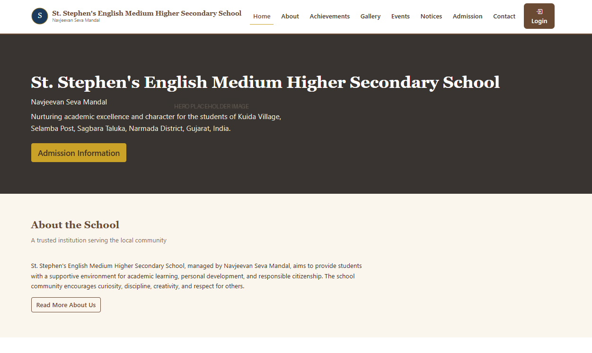
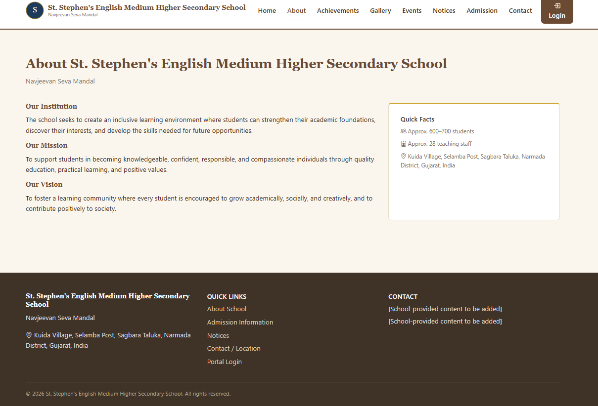
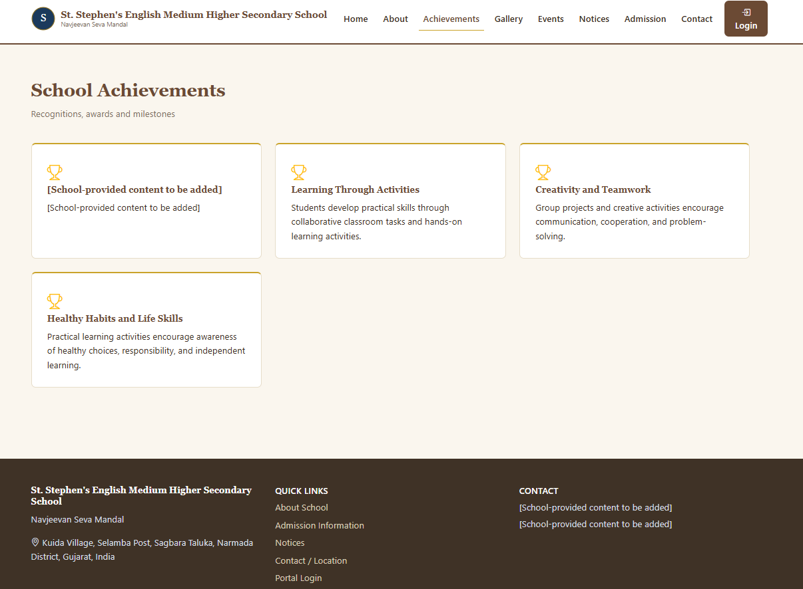
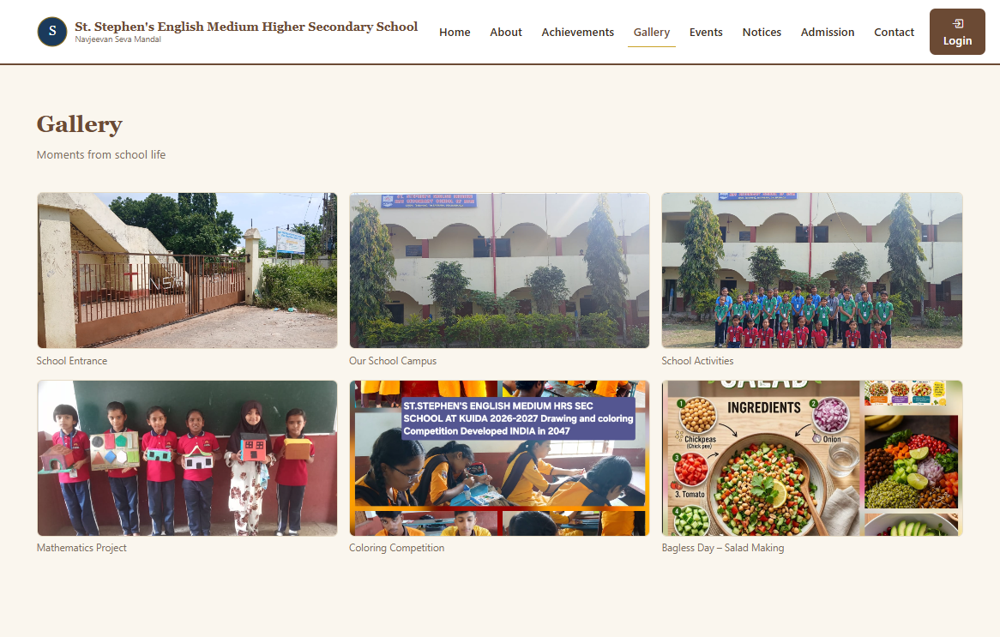
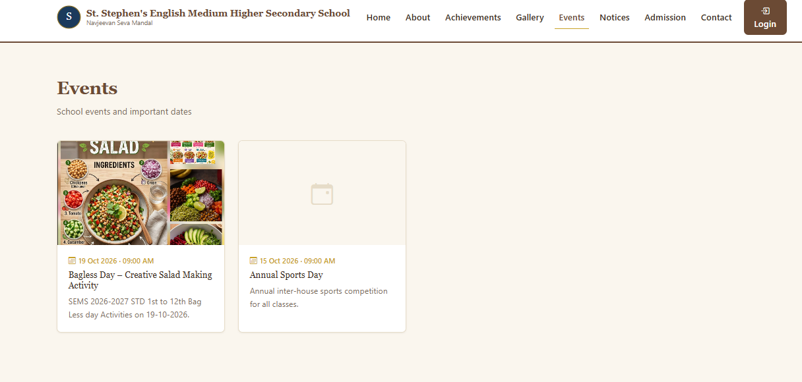
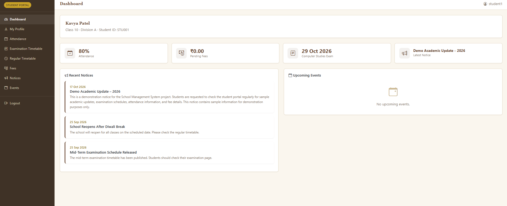
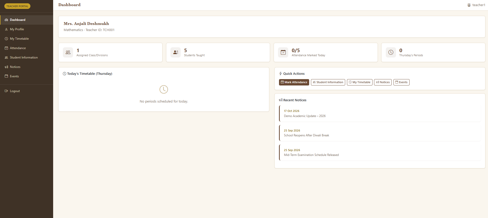
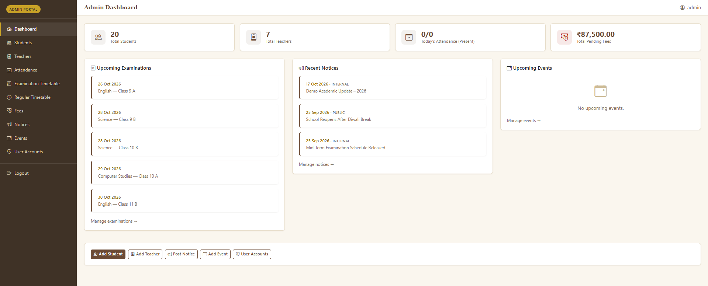
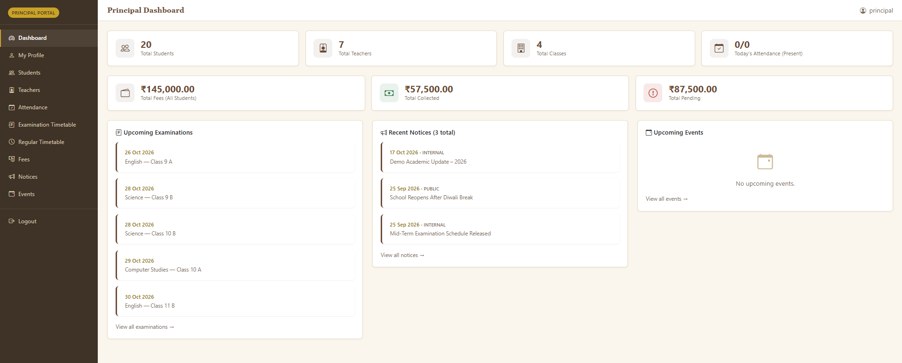

# 🏫 School Management System
**School Website, Student Records & Academic Administration System**

The School Management System is a web-based DBMS project designed to manage school information and academic activities through a centralized application. It provides a public-facing school website and separate portals for students, teachers, administrators, and the principal.

The application uses a relational database to store student, teacher, attendance, timetable, examination, fee, notice, event, gallery, and achievement information. It helps organize common school administration tasks and makes relevant information accessible through role-based interfaces.

## Features

- **Public School Website:** Display school information, achievements, gallery images, events, notices, admission information, and contact details.
- **Student Portal:** View the dashboard, profile, attendance records, examination timetable, regular class timetable, fee information, notices, and events.
- **Teacher Portal:** Access the teacher dashboard and profile, view student information, manage attendance, view timetables, and manage notices and events.
- **Admin Portal:** Manage student and teacher records, review attendance, manage examinations and timetables, maintain fee information, manage notices and events, and manage user accounts.
- **Principal Portal:** Access the principal dashboard and view relevant school information through a view-only interface.
- **Attendance Management:** Record and review student attendance.
- **Examination Management:** Maintain examination schedules and related information.
- **Timetable Management:** Organize regular class timetables and examination schedules.
- **Fee Management:** Maintain fee records and payment information.
- **Notice and Event Management:** Publish and manage school notices and events.
- **Gallery and Achievements:** Display school gallery images and achievement records.
- **Role-Based Interfaces:** Provide different application modules for students, teachers, administrators, and the principal.

## Technology Stack

| Technology | Purpose |
|---|---|
| HTML5 | Page structure |
| CSS3 | Styling and layout |
| JavaScript | Client-side interactions |
| Bootstrap 5 | Responsive user interface |
| PHP 8.x | Server-side application logic |
| PDO | PHP database connectivity |
| MySQL | Relational database |
| Apache and XAMPP | Local development environment |
| phpMyAdmin | Database administration |

## Database Design

The project uses a relational database named `school_management`.

The database export includes tables for:

- `classes` — stores class information.
- `parents` — stores parent or guardian information.
- `users` — stores user account information, password hashes, roles, and account status.
- `teachers` — stores teacher records.
- `students` — stores student records and related information.
- `attendance` — stores attendance records.
- `regular_timetable` — stores regular class timetable information.
- `examinations` — stores examination schedules and related details.
- `fees` — stores fee and payment information.
- `notices` — stores school notices and their visibility information.
- `events` — stores school event details.
- `gallery` — stores gallery image references.
- `achievements` — stores school achievement information.

The database demonstrates relational database concepts, structured data storage, CRUD operations, and the use of related records across school administration modules.

The exact primary-key and foreign-key constraints should be verified against `database/school_management.sql`.

## Requirements

- XAMPP or another compatible PHP and MySQL environment.
- PHP 8.x with PDO MySQL support enabled.
- MySQL or a compatible database server.
- Apache web server.
- A modern web browser.
- phpMyAdmin or another database administration tool.

## Installation and Setup

### 1. Copy the project

Place the project folder inside your web server's document root.

For XAMPP on Windows, this is commonly:

```text
C:\xampp\htdocs\
```

For example:

```text
C:\xampp\htdocs\school-management-system\
```

Use your actual XAMPP document root if it is different.

### 2. Start the services

Open the XAMPP Control Panel and start:

- Apache
- MySQL

Make sure the MySQL port matches your local configuration.

### 3. Create the database

Open phpMyAdmin in your browser.

1. Locate the database import option.
2. Import `database/school_management.sql` into a fresh development environment.
3. Verify that the `school_management` database and its required tables have been created.

**Important:** The supplied SQL file creates and populates the database. Import it only when setting up a fresh development database. Do not re-import it into an existing database containing information you need to preserve.

### 4. Configure the database connection

Open:

```text
config/database.php
```

Check the host, port, database name, username, and password.

The current local configuration uses:

| Setting | Current value |
|---|---|
| Host | `localhost` |
| Port | `3307` |
| Database | `school_management` |
| Username | Check `config/database.php` |
| Password | Check your local MySQL configuration |

Update these values if your local XAMPP setup uses different settings. Do not publish production credentials.

### 5. Configure the application URL

Open:

```text
config/config.php
```

Verify the `BASE_URL` setting.

The current configuration uses:

```php
define('BASE_URL', '/school-management-system');
```

If you change the project folder name or deployment path, update this setting accordingly.

### 6. Open the application

Start Apache and visit:

**Public website**

```text
http://localhost/school-management-system/public/
```

If you use a different Apache port or project path, adjust the URL accordingly.

## Main Application Modules

| Module | Description |
|---|---|
| Public Website | Displays school information, achievements, gallery, admission details, notices, events, and contact information. |
| Student Portal | Provides access to student profiles, attendance, timetables, examinations, fees, notices, and events. |
| Teacher Portal | Supports teacher profiles, student information, attendance, timetable viewing, and notice and event management. |
| Admin Portal | Provides administrative management of students, teachers, attendance, examinations, timetables, fees, notices, events, and user accounts. |
| Principal Portal | Provides a dashboard and view-only access to relevant information. |
| Database | Stores and organizes school and academic information in related tables. |

## Screenshots

Add screenshots of the actual running application to demonstrate the interface and its main features.

Suggested screenshots:

1. **Public Homepage** — the school's public-facing homepage.



2. **About and Achievements** — school information and achievement displays.




3. **Gallery and Events** — gallery images and event information.




4. **Student Dashboard** — the student portal overview.



5. **Teacher Dashboard** — the teacher portal overview.



6. **Admin Dashboard** — the administrative overview.



7. **Principal Dashboard** — the principal's view-only interface.



## Learning Outcomes

This project provides practical experience with:

- Relational database design.
- Database tables and relationships.
- PHP and PDO database connectivity.
- SQL queries and CRUD operations.
- Form handling and data validation.
- Role-based application interfaces.
- Student and teacher record management.
- Attendance and timetable management.
- Examination and fee record management.
- Dynamic content management using PHP and MySQL.
- Organizing a multi-module web application.
- Local application setup using XAMPP.

## Future Enhancements

- Improved reporting and downloadable reports.
- Parent or guardian portal.
- Automated attendance summaries.
- Email or SMS notifications.
- Online fee payment integration.
- Enhanced search and filtering.
- Additional dashboard analytics.
- Improved accessibility and responsive design.
- Automated testing and production deployment configuration.

## Academic Project

**Project:** School Management System  
**Project Type:** College Real-Time Project

Add your academic details before publishing:

- **Student:** Pillai Tony Bruce 
- **Enrollment Number:** 202503103510014
- **College:** AMTICS

This project was developed for academic learning and practical experience in web development, database management, and school administration workflows.

## Disclaimer

This project is intended for educational and demonstration purposes. Before using it in a real school environment, review its security, access controls, data protection, backup procedures, and deployment configuration. Do not use real student or staff information in public demonstrations.

## License

This project is intended for academic and educational use. Add a formal open-source license only if you want to grant the corresponding reuse permissions.
